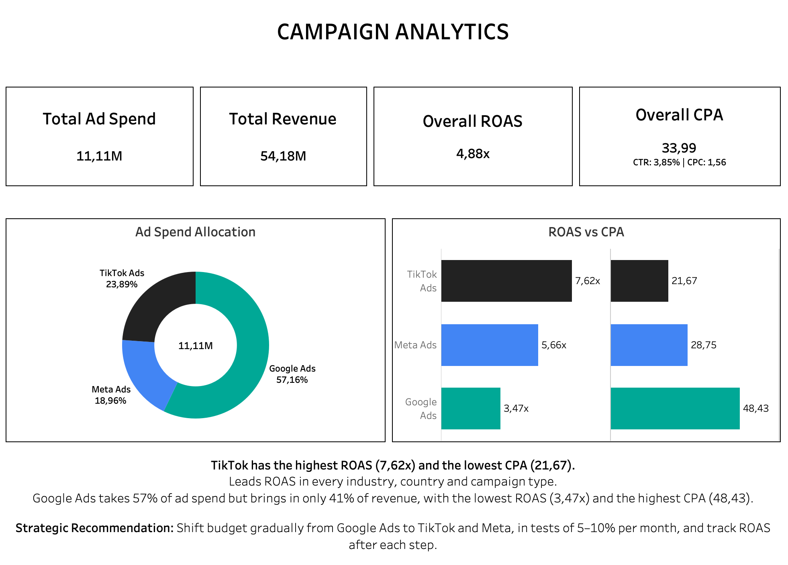
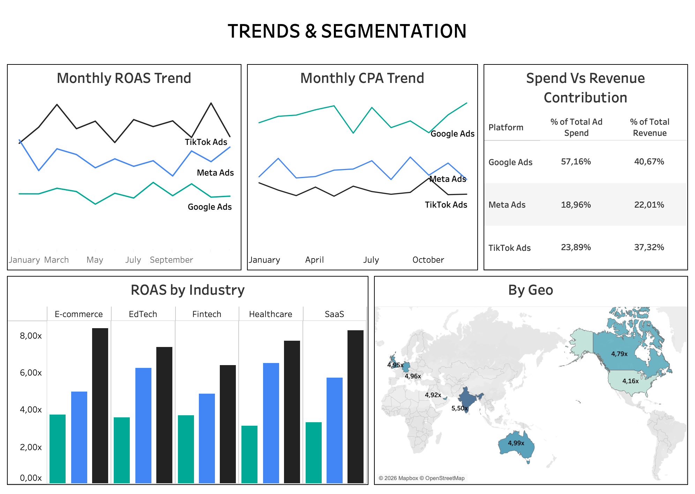

# Global Ads Performance Analytics

> **Which ad platform gives the best return on ad spend, and does that hold across industries, countries, campaign types, and months?**

An end-to-end analysis of 1800 ad campaigns (2024) across Google Ads, Meta Ads, and TikTok Ads. The data was analyzed with SQL in MySQL and presented in two Tableau Public dashboards.

## Key Findings

| Platform | Campaigns | Ad spend | Revenue | ROAS | CPA | Share of spend | Share of revenue |
|---|---:|---:|---:|---:|---:|---:|---:|
| TikTok Ads | 450 | 2,65M | 20,22M | **7,62x** | **21,67** | 23,9% | 37,3% |
| Meta Ads | 630 | 2,11M | 11,93M | 5,66x | 28,75 | 19,0% | 22,0% |
| Google Ads | 720 | 6,35M | 22,03M | 3,47x | 48,43 | 57,2% | 40,7% |
| **Total** | **1800** | **11,11M** | **54,18M** | **4,88x** | **33,99** | 100% | 100% |

- **TikTok leads ROAS in every industry (5/5), country (7/7), and campaign type (4/4)**, and in 11 of 12 months. Meta was ahead only in January (6,82x vs 6,61x). 
TikTok also has the lowest CPA in every one of those segments and in all 12 months.
- **Google Ads takes 57% of ad spend but brings in only 41% of revenue.** Its best month (4,17x) was still below Meta's worst month (4,57x).
- **The USA is the weakest market for all three platforms**, which suggests the cause is the market and not any single platform (the data cannot confirm why).

## Recommendation

Shift budget gradually from Google Ads to TikTok and Meta, in tests of 5-10% per month, and track ROAS after each step. See the limitations below for why the shift should be gradual.

## Dashboards

**Page 1 - Campaign Analytics (overview)**



**Page 2 - Trends & Segmentation**




Tableau Public: [Ads Performance Analytics dashboard](https://public.tableau.com/views/ads_performance_analytics/Dashboard1)

## Dataset

- **Source:** -[Global Ads Performance (Google, Meta, TikTok)](https://www.kaggle.com/datasets/nudratabbas/global-ads-performance-google-meta-tiktok) on Kaggle, by nudratabbas (synthetic data). The data is not included in this repository; download it and place it in `data/`.
 The data is not included in this repository; download it and place it in `data/`.
- **Size:** 1800 rows, 14 columns, covering 2024-01-01 to 2024-12-30.
- **Columns:** `date`, `platform`, `campaign_type`, `industry`, `country`, `impressions`, `clicks`, `ctr`, `cpc`, `ad_spend`, `conversions`, `cpa`, `revenue`, `roas`.
- **Dimensions:** 3 platforms, 4 campaign types, 5 industries, 7 countries.
- The dataset does not state a currency, so monetary values are shown without a currency symbol.

## Approach

1. **Database setup.** Created the table `global_ads_performance` in MySQL and added an auto-increment `ad_id` primary key.
2. **Data quality checks.**
   - Row count is 1800 and the date range is 2024-01-01 to 2024-12-30.
   - No true duplicates. 12 combinations of date, platform, campaign type, industry, and country appear twice, but their metrics differ, so they are separate campaigns.
   - The stored `roas` matches `revenue / ad_spend` for every row.
3. **Analysis.** Compared platforms overall and by industry, country, campaign type, and month. All ratios are **weighted**: `SUM(revenue) / SUM(ad_spend)` for ROAS and `SUM(ad_spend) / SUM(conversions)` for CPA. Averaging the stored `roas` column would treat a small campaign and a large one as equal, which gives the wrong answer.
4. **Visualization.** Built two Tableau Public dashboards with calculated fields that use the same weighted formulas, and checked every dashboard number against the SQL results.

## Limitations

- **ROAS measures revenue per unit of ad spend, not profit.** Product costs and margins are not in the data.
- **The results are historical averages.** Returns may fall as spend on a platform grows, so a large budget shift may not keep TikTok's ROAS. This is why the recommendation is gradual testing. There is a weak hint of this in the data: TikTok's monthly ROAS tends to be lower in months with higher spend (correlation about -0,43 across 12 months), but that is too little data to be conclusive.
- **Monthly groups are small.** TikTok has only 28 to 49 campaigns per month, so single-month swings should not be over-interpreted.
- **One year, one dataset.** The findings describe this data and may not generalize.

## Repository Structure

```
.
├── sql/
│   ├── ads_performance_dbcreation.sql   # table setup and load check
│   └── ads_performans_analysis.sql      # analysis queries
├── images/
│   ├── dashboard_1.png
│   └── dashboard_2.png
├── data/                                # not tracked (see Dataset)
└── README.md
```

## How to Reproduce

1. Download the dataset (see Dataset) and place the CSV in `data/`.
2. In MySQL, run `sql/ads_performance_dbcreation.sql` to create the table, then load the CSV into `global_ads_performance` (for example with the MySQL Workbench Table Data Import Wizard).
3. Run `sql/ads_performans_analysis.sql` to reproduce the results.

## Tools

MySQL (Workbench), SQL (aggregation, weighted ratios, date functions), Tableau Public.

## Author

Sree Malathi Elancheralathan
Data Analyst
[LinkedIn](https://www.linkedin.com/in/sree-malathik)
